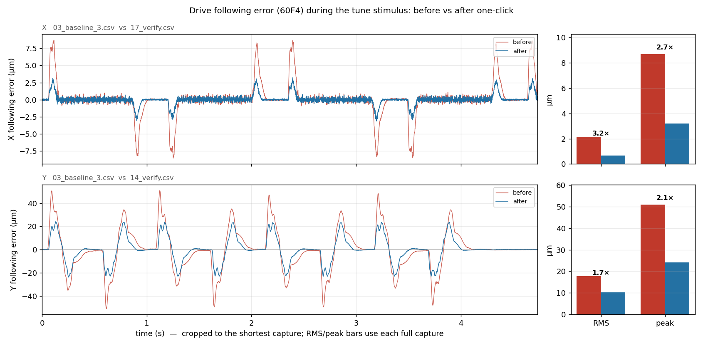
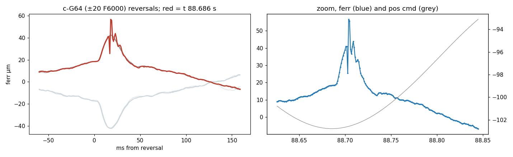

# Servo tuning (A6-EC drives)

The **Servo Tuning** tab in Probe Basic reads and writes the A6-EC drives'
gain parameters over EtherCAT and plots each drive's following error live. No
StepperOnline software or USB cable needed. It supports three ways of tuning:

| Way | What you do | Good for |
|-----|-------------|----------|
| **One-click** | Press one button per axis. It climbs the gains until the axis starts to ring, backs off, and saves the result | A first tune, or retuning after mechanical changes |
| **AI-assisted** | Run a test move, copy the plot and gains, paste them into an AI chat, apply its suggestion yourself | Judgment calls: filters, notches, "does this look right?" |
| **Manual** | Follow the zone ladder below | Learning how the loops behave |

The approach is based on [kalico sota-motion](https://github.com/dderg/kalico/tree/sota-motion).

Everything here is specific to **StepperOnline A6** drives: parameter numbers,
presets, the one-click ladder. On a different drive family, read
[SERVO_SWAP.md](SERVO_SWAP.md) first and don't point these parameter numbers at
it.

---

## Three rules

1. **Tune on the drive's following error, not LinuxCNC's.** The plot shows
   CiA object **60F4**, which the drive computes at its own servo rate.
   LinuxCNC's `joint.N.f-error` includes EtherCAT round-trip lag and is only
   used for fault limits. An earlier attempt to "fix" LinuxCNC's number by
   rewiring HAL was removed. Don't bring it back.
2. **Never put loop gains in `ethercat-conf.xml`.** lcec writes those SDOs on
   every LinuxCNC start, so they'd overwrite your tuning every launch. The XML
   only sets the fault window (6065/6066) and `C01.10`.
3. **Every write is permanent.** The A6-EC stores SDO writes in its EEPROM
   by itself: **C13.10 "EtherCAT parameter storage" = 1** (`0x2013:11`, the
   factory default; all four drives read 1 on 2026-11-28). APPLY, one-click
   and the inertia tool all persist across a power cycle, so a bad tune
   doesn't go away on its own. LOAD the backup preset and APPLY to undo.
   Check it with `ethercat upload -p 0 -t uint16 0x2013 0x11`. (Older docs
   here said "RAM only". That was an assumption, never tested.) Writing many
   parameters very often can raise **ALF1.3** "too frequent writing of EEPROM
   by host controller SDO".

---

## Before you start

- `ethercat` must work without sudo (the udev rule in
  [SETUP.md](SETUP.md#install-notes)). The tab falls back to `sudo -n`, which
  only works with passwordless sudo.
- `python3-pyqtgraph` for plots, `python3-numpy` for the FFT.
- Set the load inertia ratio (C00.06) first if you can. See
  [INERTIA_TUNING.md](INERTIA_TUNING.md). The factory 100 % is often good
  enough to start.

---

## The tab

| Control | Does |
|---------|------|
| Axis buttons | Choose which axes are plotted. The last one clicked is the one you edit |
| *(auto-read)* | Drive parameters load when you open the tab or pick an unread axis |
| Parameter table | Current (on the drive) and Pending (your edits), with units and ranges |
| **APPLY TO DRIVE** | Turns the machine off if needed, writes the Pending values with read-back checks and retries, turns it back on |
| **START PLOT / STOP PLOT** | Live following-error plot (polls only while on and visible; nothing saved). While on, it also starts a realtime `sampler.0` stream of all four axes (last 20 s) for ANALYZE |
| **MM / PULSES** | Plot units |
| **FERR / FFT** | Switch between the time plot and the spectrum from **ANALYZE** |
| **ANALYZE** | FFT of the last 10 s: finds resonances and gives a stable / unstable verdict. Uses the realtime stream at the true servo rate; the result line ends with `realtime 1000 Hz`. If the sampler isn't loaded it falls back to the polled plot and says `polled (approximate frequencies)` — don't place a notch from that |
| **USE SUGGESTED NOTCH 3** | Loads the main resonance into notch 3 (C01.46–48) in Pending |
| **COPY TUNING / COPY PLOT / COPY RESONANCE** | Put the gains, plot image or FFT report on the clipboard |
| **PRESET** | Load (into Pending only) / save / delete named gain sets, stored in `config/tuning/presets/<axis>/` |
| **ONE-CLICK TUNE** | See [ONE_CLICK_TUNING.md](ONE_CLICK_TUNING.md) |
| **INERTIA** panel | See [INERTIA_TUNING.md](INERTIA_TUNING.md) |

### Where ANALYZE gets its data

The scrolling plot is a display only: Python polls it from the Qt timer, and
the real rate varies (250–750 Hz was measured in July). An FFT of that puts
every peak at the wrong frequency, so from 2026-11-27 ANALYZE doesn't use
it:

- **START PLOT** also starts `RtStream` (`rt_capture.py`). It reads the
  realtime `sampler.0` (end of `custom.hal`), one row per servo cycle for all
  four axes, and keeps the last 20 s.
- **ANALYZE / COPY RESONANCE** take the last 10 s of the selected axis from
  it, at the true rate. The result line ends with `realtime 1000 Hz`.
- Jog or run the move you want to look at with the plot on, then press
  ANALYZE within 10 s. To look at a resonance, a few sharp back-and-forth
  jogs work better than one long move.
- If the sampler isn't loaded, the line says `polled (approximate
  frequencies)`. The verdict is still roughly right, but **don't place a
  notch from a polled result**.
- Only one reader can use `sampler.0` at a time. ONE-CLICK stops the stream
  and restarts it when it finishes. A second tuner window gets "sampler.0 is
  already capturing" (see TROUBLESHOOTING).

`C01.10` (speed feedback filter) and `C01.38` (gain switchover mode) are
read-only on this firmware, so APPLY skips them. Set gain switchover to
"fixed 1st set" on the drive panel if you need to.

---

## One-click

Home, clear the axis's travel, machine on, hand near the E-stop. Pick the
axis, pick a profile (**BALANCED** unless you have a reason), press
**ONE-CLICK TUNE**. It journals every step and restores the original gains if
anything goes wrong or you cancel. Since engine v2 (2026-11-27) it needs the
realtime capture block in `custom.hal` and settles at a fixed stability
margin, so results land lower than the July presets. Full details:
[ONE_CLICK_TUNING.md](ONE_CLICK_TUNING.md).

### First machine runs of engine v2.1 (2026-11-27)

| Axis | Before (speed / position / integral) | After | Following error, same test move | Kept? |
|------|--------------------------------------|-------|---------------------------------|-------|
| X | 80 Hz / 130 rad/s / 5 ms | **150 Hz / 360 rad/s / 3 ms** (position hit the BALANCED cap) | RMS 2.15 → 0.67 µm (3.2×), peak 8.7 → 3.2 µm (2.7×) | Yes |
| Y | 30 Hz / 90 rad/s / 10 ms | **37.5 Hz / 90 rad/s / 3 ms** | RMS 17.7 → 10.3 µm (1.7×), peak 51 → 24 µm (2.1×) | Yes |
| Z | 26 Hz / 50 rad/s / 3 ms | 34.4 Hz / 82.5 rad/s / 3 ms | RMS 19.3 → 10.4 µm (1.9×), peak 49 → 28 µm (1.7×) | **No: audible whine.** Back on 26 / 50 / 3 |

Torque FF stayed where it was (X 120 %, Y 125 %, Z 200 %). Each axis used its
own default test move (X 40 mm F3000, Y 15 mm F10000, Z 10 mm F6000), so
compare before/after within a row, not across rows.



- **The new X and Y gains are already saved** in the drives' EEPROM (rule 3:
  C13.10 = 1), and so is Z's revert. The `new_tuning` presets are the
  file copies.
- **Z needed two tuner fixes first** (warm-up move, gravity-aware standstill
  check; see ONE_CLICK_TUNING.md lessons). The fixed run then passed every
  check, but the result whined. The tuner listens up to 500 Hz (1 kHz
  sampling) and to standstill torque *ripple*; a whine above that is
  invisible to it. Your ears are the last check on Z.
- Make before/after plots of any runs with
  `python3 scripts/plot_tune_before_after.py <run dirs…> -o out.png`
  (run from `logs/tuning/one_click/`; `DIR:before.csv,after.csv` picks
  captures by hand, e.g. a baseline from an earlier run).

## AI-assisted

1. Open the tab, pick the axis, **START PLOT**.
2. Run that axis's test program (below) in AUTO.
3. **COPY PLOT** and **COPY TUNING**, paste both into an AI chat along with
   [SERVO_TUNING_LLM.md](SERVO_TUNING_LLM.md) (that file tells the AI how to
   read the plot and what to suggest).
4. Type its suggestion into Pending, **APPLY TO DRIVE**, and repeat from step 1.
5. **SAVE AS PRESET** when you have something good.

The AI never writes to the drive. You do. Use the **same test program for a
whole session**. If you change it, earlier plots aren't comparable any more.

---

## Manual tuning: the zone ladder

The drive is a cascade: position loop → speed loop → torque loop. Tune from the
fastest (highest frequency) part to the slowest, one knob at a time, running
the same move and watching the plot after every change.

| Parameter | Role |
|-----------|------|
| C01.03 torque filter / notches | Remove high-frequency buzz and resonances |
| C01.01 speed loop gain (Hz) | Inner stiffness and damping |
| C01.02 speed integral (ms) | Removes steady lag. Lower ms = stronger |
| C01.00 position loop gain (rad/s) | Outer tracking: main lever on following error |
| C00.06 inertia ratio (%) | Scales everything. Set it first |

1. **Prep.** Fixed 1st gain set, soft gains, one repeatable test move.
2. **Filters.** If it already buzzes or rings, lower the torque filter or add a
   notch at the ring frequency (ANALYZE finds it). Don't chase following
   error with filters.
3. **Speed gain.** Raise C01.01 until the plot tracks cleanly. When a tap on
   the axis starts a sustained buzz, back off about 20 %. Then tighten the
   integral (lower C01.02 ms) a little to remove lag. Keep it as weak as works.
4. **Position gain.** Raise C01.00 until peak error stops improving. A good
   ratio is position (rad/s) ≈ 2 × speed (Hz). If overshoot or ringing grows,
   back off 20 %.
5. **Polish.** Notches for leftover rings. Test both directions and real
   cutting loads.

| Symptom | Change |
|---------|--------|
| Big error during acceleration, smooth trace | Raise position, then speed (keep the ratio) |
| Steady offset at rest | Lower integral ms a little |
| Buzz when pushed or after a move | Lower speed gain and/or torque filter |
| High-pitched ring | Lower torque filter, then a notch |
| Soft and laggy after quietening it | Raise speed a little, then position |

**Jagged, growing ringing after a gain increase is a hard stop.** Revert and
treat it as a vibration problem, not a gain problem.

---

## Test programs

The AI-assisted and manual workflows need one fixed back-and-forth program per
axis. Put these in your `PROGRAM_PREFIX` folder. Adjust the stroke to your
travel once, then leave it alone.

| File | Move |
|------|------|
| `x_tuning.ngc` | 10× X 0 ↔ 80 mm at F1000 |
| `y_tuning.ngc` | 10× Y 0 ↔ 15 mm at F30000 |
| `z_tuning.ngc` | 1× Z 0 ↔ 15 mm at F10000 |
| `a_tuning.ngc` | 10× A 0 ↔ 90° at F3600 |

All four follow the same pattern (X shown):

```ngc
(x_tuning.ngc: fixed tuning stimulus, don't edit mid-session)
G21 G90 G61
G0 X0
#1 = 10
o100 while [#1 GT 0]
  G1 X80 F1000
  G4 P0.5
  G1 X0 F1000
  G4 P0.5
  #1 = [#1 - 1]
o100 endwhile
M2
```

The moves are relative to wherever the work offset puts 0, so check clearance
first. One-click doesn't need these. It generates its own moves.

---

## Reversal / clunk test

A repeatable air-move test that looks for a "clunk" (backlash, a loose ball
nut, a timing glitch) in the drive's following error at direction reversals.
It uses only 60F4 and the commanded position, captured every servo cycle.

**1. Program.** `python3 scripts/clunk_test_gcode.py Y` writes
`~/linuxcnc/nc_files/clunk_test_Y.ngc` (any of X/Y/Z). One axis only, `G91`,
every stroke goes + then −, so the axis stays between the start point and
start + 20 mm. Six blocks of 10 cycles, 0.5 s dwell between blocks, first
with `G61` then with `G64 P0.01`, about 100 s in all:

| Block | Stroke | Feed |
|-------|--------|------|
| a | ±20 mm | F1000 |
| b | ±20 mm | F3000 |
| c | ±20 mm | F6000 |
| d | ±20 mm | F12000 (Z clamps to its 10000 max) |
| e | ±2 mm | F3000 (reversal-heavy) |
| f | ±0.1 mm | F500 (tiny strokes: backlash on its own) |

`clunk_test_gcode.py Y 3` writes `clunk_stress_Y.ngc`, the same thing three
times (about 5 minutes). For Z, start low enough that start + 20 mm stays at
or below G53 Z0 (the generator assumes + first).

**2. Capture.** Raise Z, jog the axis to where it has 20 mm of room, machine on,
Servo Tuning plot stopped, then:

```bash
source ~/src/linuxcnc-tpnext/scripts/rip-environment
python3 scripts/clunk_capture.py Y                 # checks only
python3 scripts/clunk_capture.py Y --run           # runs the program and captures
python3 scripts/clunk_capture.py Y --program clunk_stress_Y.ngc --tag stress --run
```

The checks refuse to run unless the machine is on and idle, the axis is homed,
the spindle is off, `sampler.0` is free and start..start+20 is inside the soft
limits. The capture uses `rt_capture.RtCapture` and saves
`logs/clunk/<time>_<AXIS>[_tag].csv` with `t_s, pos_cmd_mm, ferr_mm` plus the
X/Y/Z following error of the same cycle (a timing glitch hits every axis, a
mechanical one only the moving axis). The first line holds the health check:
samples vs expected, overruns. A FIFO overrun or a sample-count mismatch saves
the file as `..._UNTRUSTED.csv` and exits 1.

**3. Analysis.** `python3 scripts/clunk_analyze.py logs/clunk/<file>.csv[.gz]`
finds every reversal (sign change of the commanded velocity), takes −50 to
+150 ms around it, and reports per block: peak |FERR|, the largest
single-cycle jump, and ringing (RMS after removing a 20 ms moving average,
20–150 ms after). It writes `_report.md`, `_reversals.json`, `_run.png` (whole
run, reversals marked) and `_overlay.png` (all reversals of each block
aligned). Read these columns with care:

- **`n >3x base`** compares against cruising mid-stroke, so a reversal on a
  fast block always exceeds it. It can't single out a clunk on its own.
- **`n >med+5MAD`** flags outliers within a block. FERR comes in whole counts
  (0.076 µm), so the median spread is tiny and one count over gets flagged.
  Look at the size, not the count.
- **Asymmetry** (+→− minus −→+): backlash or a loose nut shows as a
  consistent difference. Expect gravity to add some on Z.

**Results on Y (2026-11-27/28), new gains:** no mechanical clunk signature.
Every block's reversals overlay on one line, and the asymmetry is ≤ 1.7 µm on
peak, ≤ 0.5 µm on jump. One event on the generic EtherCAT driver (88.7 s,
c-G64) was a one-cycle timing glitch, not mechanics: see
[SETUP.md](SETUP.md#ethercat-driver-and-timing).



Typical numbers to compare against (Y, new gains): reversal peak FERR 23–27 µm
with `G61`, 17 µm (F1000) to 42 µm (F6000+) with `G64`; largest single-cycle
jump 1.4–3.4 µm; cruising baseline 2 µm peak, 0.7 µm jump.

---

## Presets

Presets are JSON files in `config/tuning/presets/<axis>/`. **LOAD** only fills
Pending, so you still have to press APPLY. What's on the drives now
(2026-11-28):

| Axis | Preset | Speed / position / integral / torque FF |
|------|--------|-----------------------------------------|
| X | `new_tuning` (= `one_click_20261127_233624`) | 150 Hz / 360 rad/s / 3.0 ms / 120 % |
| Y | `new_tuning` (= `one_click_20261127_233343`) | 37.5 Hz / 90 rad/s / 3.0 ms / 125 % |
| Z | `pre_one_click_20261127_233712` (the pre-tune values) | 26 Hz / 50 rad/s / 3.0 ms / 200 % |

Z's `new_tuning` and `one_click_20261127_234730` hold the 34.4 Hz / 82.5 rad/s
tune that whined. Don't load them.

Older sets (2026-07-12, engine v1, sampled at the wrong rate):

| Axis | Preset | Speed / position / integral |
|------|--------|-----------------------------|
| X | `one_click_best_20260712` | 150 Hz / 224.6 rad/s / 5.0 ms |
| Y | `one_click_best_20260712` | 164.6 Hz / 60 rad/s / 3.5 ms |

To write a preset's gains from a script (same path as APPLY: machine off,
write, read back, machine on):

```bash
source ~/src/linuxcnc-tpnext/scripts/rip-environment
cd probe_basic/python && python3 -c "
import a6_servo_tune as t
p = t.load_preset('Z', 'pre_one_click_20261127_233712').params
print(t.apply_axis_params('Z', p, keys=['pos_gain_rad_s', 'speed_gain_hz']))"
```

One-click also saves timestamped `pre_one_click_*` (backup) and
`one_click_*` (result) presets every run.

---

## Drive parameters reference

| SDO | Panel | Meaning |
|-----|-------|---------|
| `0x2000:05` | C00.04 | Gain mode (0 = manual. One-click forces this) |
| `0x2000:07` | C00.06 | Load inertia ratio, % |
| `0x2001:01` | C01.00 | Position loop gain, 0.1 rad/s |
| `0x2001:02` | C01.01 | Speed loop gain, 0.1 Hz |
| `0x2001:03` | C01.02 | Speed integral, 0.01 ms |
| `0x2001:31` | C01.30 | Adaptive notch mode |
| `0x2013:05` | C13.04 | EtherCAT sync loss count (read only) |
| `0x2013:0A` | C13.09 | Invalid EtherCAT frames (read only). Slave 0 read 24 064 on 2026-11-28, the others 0. Watch whether it grows |
| `0x2013:11` | C13.10 | EtherCAT parameter storage: 1 = SDO writes go to EEPROM (default) |
| `0x2013:13` | C13.12 | EtherCAT IRQ loss count (read only) |
| `0x6065` | | Following-error window, counts (6554 = 0.5 mm. A: 3641 = 10°, widened while A is unconnected; normally 182 = 0.5°) |
| `0x6066` | | Following-error time, ms (250) |

Read one by hand (the A6 doesn't describe its own types, so `-t` is required):

```bash
ethercat upload -p 0 -t uint16 0x2001 0x02   # slave 0 speed gain
```

---

## Copying the tabs to another machine

1. **Copy** `probe_basic/user_tabs/servo_tuner/` (and `signal_monitor/` for
   the Logging tab), plus from `probe_basic/python/`: `a6_servo_tune.py`,
   `a6_auto_tune.py`, `a6_auto_tune_sim.py`, `a6_graphical_inertia.py`,
   `resonance_analysis.py`, `rt_capture.py`, `frf_analysis.py`, `tune_trial.py`,
   `hal_signal_logger.py`, `signal_plot_widget.py`. Optionally
   `scripts/run_auto_tune.py`, `scripts/test_live_gain_write.py` and `config/`.
2. **EtherCAT XML.** Map PDOs 60F4 (`ferr-fb`), 6077 (`torque-fb`) and 606C
   (`vel-fb`) on every slave.
3. **HAL.** Copy the telemetry block in `custom.hal` that makes
   `tune-drive-ferr.N`, `tune-torque.N` and `tune-velocity.N`, and the
   REALTIME CAPTURE block at its end (`sampler.0`, needed by one-click). Never wire
   these into `joint.N.f-error`. The `tune-velocity.N.gain` values are
   1/SCALE typed in by hand, so recompute them for your scale.
4. **Python.** Edit the `AXES` table in `a6_servo_tune.py`: joint, slave,
   linear or rotary, and `scale`, which **must** match the INI `SCALE`.
   Otherwise the plot units and the 6065 window are wrong.
5. **Test.** `python3 scripts/run_auto_tune.py --axis X --sim` (no hardware),
   then `--dry-run` on the machine, before a real run.

On the machine: the tab's Current column should fill in (not "READ FAIL"), and
`halcmd getp tune-drive-ferr.0.out` should change when you jog.

---

## Files

| File | Role |
|------|------|
| `probe_basic/user_tabs/servo_tuner/` | The tab |
| `probe_basic/python/a6_servo_tune.py` | SDO read/write, presets, axis table |
| `probe_basic/python/a6_auto_tune.py` | One-click engine |
| `probe_basic/python/a6_graphical_inertia.py` | Inertia identification |
| `probe_basic/python/resonance_analysis.py` | FFT stability check |
| `probe_basic/python/frf_analysis.py` | Sensitivity \|S\| (Ms, implied gain/phase margin) from command vs FERR |
| `probe_basic/python/rt_capture.py` | Realtime capture via `sampler.0` + `halsampler` |
| `scripts/test_live_gain_write.py` | Checks whether gains can be written with the drive enabled |
| `scripts/plot_tune_before_after.py` | Before/after FERR plot of one-click runs |
| `scripts/clunk_test_gcode.py`, `clunk_capture.py`, `clunk_analyze.py` | Reversal / clunk test: program, realtime capture, analysis |
| `probe_basic/python/tune_trial.py` | Clipboard text and images |
| `custom.hal` (end) | Drive telemetry → `tune-*` pins; `sampler.0` realtime capture |
| `config/tuning/presets/` | Saved gain sets |
| `logs/tuning/one_click/` | One-click journals and FERR captures (in git) |
| `logs/clunk/` | Clunk test captures (`.csv.gz` in git), reports and plots |
