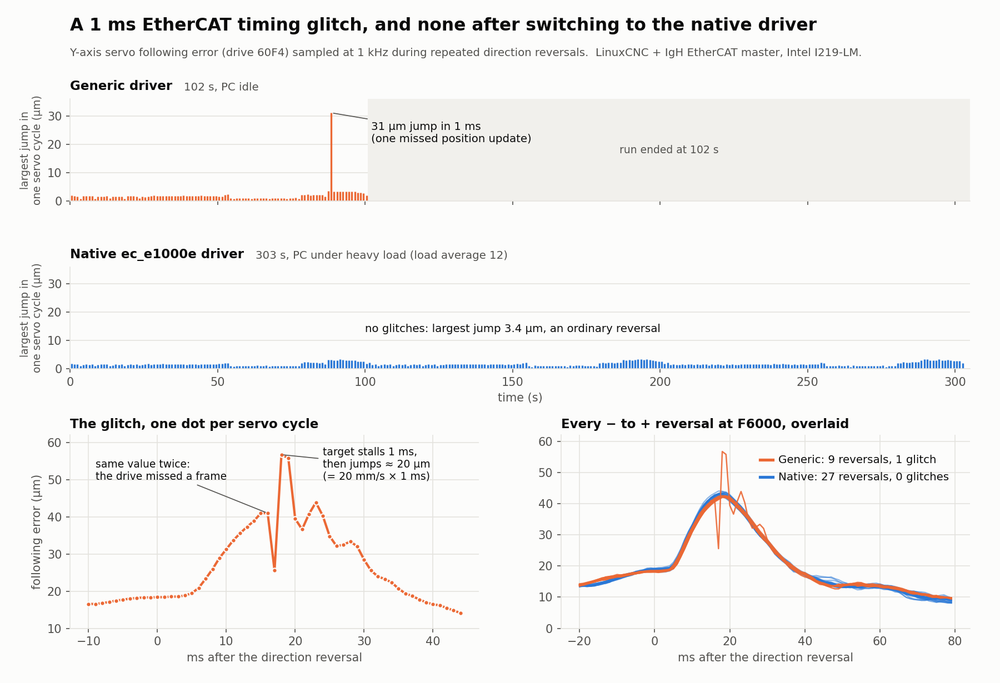

# Setup: from a bare PC to a running mill

This page takes you from an empty PC to this config running on your own
hardware. It covers the software stack first, then a staged bring-up where each
stage proves one subsystem before you add the next.

If LinuxCNC is new to you, don't start with this repo. Get a stock simulator
config running first and learn the basics there (stage 0 below). Probe Basic
and EtherCAT each add a lot of moving parts, and it's much easier to debug them
one at a time.

---

## The software stack

This is what the mill runs today. Matching it closely saves a lot of grief.

| Piece | Version on this mill | Where it comes from |
|-------|----------------------|---------------------|
| OS | Debian 13 (trixie) | debian.org |
| Kernel | 6.12 PREEMPT_RT (`linux-image-rt-amd64`) | Debian |
| LinuxCNC | 2.9.8, `linuxcnc-uspace` | LinuxCNC apt repo (`trixie base 2.9-uspace`) |
| EtherCAT master | IgH 1.6.8 (`ethercat-master`, `ethercat-dkms`) | EtherLab repo on openSUSE Build Service |
| LinuxCNC EtherCAT driver | linuxcnc-ethercat v1.41+ | Built from source ([GitHub](https://github.com/linuxcnc-ethercat/linuxcnc-ethercat)) |
| UI | Probe Basic 0.6.6, QtPyVCP 5.1.0 | QtPyVCP apt repo |
| Extras | `python3-pyqtgraph`, `python3-numpy`, `mpg123` | Debian |

### Install notes

1. **Real-time kernel.** Install `linux-image-rt-amd64`, reboot into it, and run
   `latency-test` for a few minutes under load. EtherCAT at 1 kHz wants max
   jitter well under 100 µs.
2. **LinuxCNC.** Follow the [official install guide](https://linuxcnc.org/docs/html/getting-started/getting-linuxcnc.html)
   for the apt repo, then `sudo apt install linuxcnc-uspace linuxcnc-uspace-dev`.
3. **EtherCAT master.** Add the EtherLab OBS repo and install `ethercat-master`
   and `ethercat-dkms`. Then edit `/etc/ethercat.conf`:

   ```bash
   MASTER0_DEVICE="aa:bb:cc:dd:ee:ff"   # MAC of the NIC the drives plug into (ip link)
   DEVICE_MODULES="generic"             # start here; see "Native driver" below
   ```

   Use a NIC dedicated to EtherCAT. Start it with `sudo systemctl enable --now ethercat`.
   Get everything working on `generic` first, then switch to the native driver.
   See [EtherCAT driver and timing](#ethercat-driver-and-timing).

   **Note:** this mill runs the **tpnext** LinuxCNC build. Any script that talks
   to the running machine (`halcmd`, `import linuxcnc`, `scripts/clunk_*.py`,
   `rt_capture.py`) must run after
   `source ~/src/linuxcnc-tpnext/scripts/rip-environment`. Without it you get
   `HAL: ERROR: version code mismatch` and `linuxcnc.stat()` returns all zeros.
4. **Let normal users talk to the master.** The servo tuning tab calls the
   `ethercat` command without sudo. Create `/etc/udev/rules.d/99-ethercat.rules`:

   ```
   KERNEL=="EtherCAT[0-9]*", MODE="0666"
   ```

5. **linuxcnc-ethercat.** Clone it and build it as its README describes
   (`make && sudo make install`). This mill runs v1.41 or newer, and the DC
   clock settings in `ethercat-conf.xml` were written against it.
6. **Probe Basic.** Add the QtPyVCP apt repo and `sudo apt install python3-probe-basic`.
   The [Probe Basic docs](https://github.com/kcjengr/probe_basic) cover this.
7. **Extras.** `sudo apt install python3-pyqtgraph python3-numpy mpg123`.
   pyqtgraph draws the plots on the tuning and logging tabs. numpy runs the FFT
   in the tuning code. mpg123 plays the probe beep.
8. **Serial ports.** Add yourself to the `dialout` group
   (`sudo usermod -aG dialout $USER`, then log out and back in) so mb2hal can
   open the USB-RS485 adapters.
9. **Pendant.** The LinuxCNC package already ships the udev rule for the
   WHB04B-6, so there is nothing to add.

**Python packages: use apt, not pip.** LinuxCNC and Probe Basic come from apt
and are tied to the system Python. Installing pyqtgraph with pip on top of
the apt version causes hard-to-trace import errors. If you did that already:
`pip uninstall pyqtgraph && sudo apt install python3-pyqtgraph`.

### Stock LinuxCNC vs the tpnext build

The `dev-jerk-testing` branch runs on an experimental jerk-limited trajectory
planner ("tpnext"), built separately in `~/src/linuxcnc-tpnext` and started
with `launch-tpnext.sh`. Its INI has keys that stock 2.9 doesn't understand:

```ini
[TRAJ]
TPMOD = tpnextmod
PLANNER_TYPE = 1
MAX_LINEAR_JERK = 30000.0
DEFAULT_LINEAR_JERK = 30000.0
# ...and MAX_JERK in each [AXIS_*] / [JOINT_*]
```

**On stock LinuxCNC 2.9, comment out `TPMOD`** (stock has no `tpnextmod`
module) and start with `launch.sh`. The other jerk keys are only used by
tpnext. The `main` branch doesn't have these keys.

One stock 2.9 quirk worth knowing: with `G64` blending, a stop-to-stop move
only gets **half** of `MAX_ACCELERATION` (LinuxCNC issue #4220). Put `G61` in
test programs when you're measuring acceleration.

### EtherCAT driver and timing

**This mill runs the native `ec_e1000e` driver** on the PC's onboard Intel
I219-LM (PCI `8086:15b7`), since 2026-11-28. Before that it ran `generic`.

| Driver | How frames travel | Trade-off |
|--------|-------------------|-----------|
| `generic` | Through the normal Linux network stack. The NIC interrupt and packet handling run on the shared (non-isolated) CPUs | Works with any NIC. The servo thread can get stuck waiting on network-stack locks held by busy tasks on those CPUs |
| native (`e1000e`, `igb`, `r8169`, …) | The master drives the NIC directly from the servo thread. No network stack, no NIC interrupt | Lower, steadier latency. Only for NICs IgH has a driver for, and the NIC disappears as a normal interface |

**Why it was switched.** A realtime following-error capture on Y found one
glitch in 102 s on `generic`: the drive's 60F4 repeated a sample, then swung
−11 / +20 µm for 3 ms and rang for ~5 ms. At 20 mm/s, one servo cycle of
travel is exactly 20 µm, so the drive missed one position update (frame
arrived outside its sync window), then got two at once. The EtherCAT master
showed 0 lost frames, and the servo thread's worst cycle was 557 µs against a
29 µs typical. On the native driver, a 303 s stress run (same Y program three
times, all three shared cores pinned at 100 % plus disk scanning, load average
up to 12.6) showed 0 glitches, largest single-cycle jump 3.4 µm, and the
worst servo cycle stayed at 332 µs (from startup) through the whole run.



Not proof: on `generic` the glitch was rare (1 in ~9 minutes of capture), so
5 clean minutes fits the fix without proving it. The same stress run on
`generic` would settle it. Data: `logs/clunk/`, test method:
[SERVO_TUNING.md](SERVO_TUNING.md#reversal--clunk-test).

**What `/etc/ethercat.conf` has now** (backup of the generic version:
`/etc/ethercat.conf.bak-generic`):

```bash
MASTER0_DEVICE="00:23:24:d6:7e:3d"
DEVICE_MODULES="e1000e"
#UPDOWN_INTERFACES="eno1"      # commented out: eno1 no longer exists as a netdev
```

**Switching drivers: stop, edit, start. Never edit-then-restart.** LinuxCNC
must be closed.

```bash
sudo systemctl stop ethercat
sudo rmmod ec_generic ec_e1000e ec_master 2>/dev/null; lsmod | grep '^ec_'   # must print nothing
sudo sed -i 's/^DEVICE_MODULES="generic"/DEVICE_MODULES="e1000e"/; s/^UPDOWN_INTERFACES="eno1"/#UPDOWN_INTERFACES="eno1"/' /etc/ethercat.conf
sudo systemctl start ethercat
```

`systemctl restart ethercat` after editing does **not** work. The stop half
reads the *new* config, so it never unloads the old driver module. The new
driver then binds the NIC but the master can't use it: `ethercat master` shows
Tx errors climbing, 0 Tx frames, 0 slaves (seen 2026-11-28, and wrongly
blamed on the I219 at first). Fix: the `rmmod` line above, then start.

Check before starting LinuxCNC:

```bash
readlink /sys/bus/pci/devices/0000:00:1f.6/driver   # .../ec_e1000e
ethercat master | grep -E "Slaves|Tx errors"        # Slaves: 4, Tx errors: 0
ethercat slaves                                     # 4 lines, PREOP
```

Then start LinuxCNC with the machine **off** and check `ethercat slaves` (all
OP), `halcmd show pin lcec.0 | grep dc-` (`dc-sync-converged` TRUE) and
`halcmd show thread` before enabling. Measured on native: DC reference error
30–44 µs (19 µs on generic), servo thread 40–70 µs typical (29 µs on generic,
because the thread now does the NIC work itself).

**Going back to generic** (same rule, stop first):

```bash
sudo systemctl stop ethercat; sudo rmmod ec_e1000e ec_master 2>/dev/null
sudo cp /etc/ethercat.conf.bak-generic /etc/ethercat.conf && sudo systemctl start ethercat
```

The IgH DKMS package builds every native driver for the running kernel
(`ls /lib/modules/$(uname -r)/updates/dkms/ec_*`). To check that yours covers
your NIC, look for its PCI ID in the driver's table:
`python3 -c "import lzma;print(lzma.open('/lib/modules/$(uname -r)/updates/dkms/ec_e1000e.ko.xz').read().count(bytes.fromhex('86800000b7150000')))"`
(1 = listed; the bytes are vendor 8086 + device 15b7, little-endian).

**Other realtime settings on this PC:**

| Setting | Value | Notes |
|---------|-------|-------|
| Kernel command line | `isolcpus=3 intel_idle.max_cstate=0 processor.max_cstate=0` | Servo thread (`rtapi_app:T#0`, FIFO 98) runs alone on CPU 3. C-states limited to C1 |
| CPU governor | `performance` on all cores | One-shot unit `/etc/systemd/system/cpu-performance.service` writes it at boot (`cpupower` isn't installed). Was `powersave`, which lets cores drop to 800 MHz |
| Turbo | off (`intel_pstate/no_turbo = 1`) | Steadier clock |
| Not set | `nohz_full`, `rcu_nocbs`, `irqaffinity` | Possible next steps if latency still shows up |

The governor unit:

```ini
# /etc/systemd/system/cpu-performance.service
[Unit]
Description=CPU governor performance (LinuxCNC realtime)
[Service]
Type=oneshot
ExecStart=/bin/sh -c 'for g in /sys/devices/system/cpu/cpu*/cpufreq/scaling_governor; do echo performance > $g; done'
RemainAfterExit=yes
[Install]
WantedBy=multi-user.target
```

Enable with `sudo systemctl daemon-reload && sudo systemctl enable --now cpu-performance.service`.

---

## Get the config

```bash
mkdir -p ~/linuxcnc/configs && cd ~/linuxcnc/configs
git clone https://github.com/jayem1427/lemontart_lcnc_config.git ethercat_mill
cd ethercat_mill
```

Then make these edits before the first launch:

| File | Change |
|------|--------|
| `ethercat_mill.ini` | `PROGRAM_PREFIX` → your G-code folder |
| `ethercat_mill.ini` | `[JOINT_*] SCALE`, limits, velocities. See [HARDWARE.md](HARDWARE.md#motion) |
| `ethercat-conf.xml` | One `<slave>` per drive, in bus order. See [CONFIG_TOUR.md](CONFIG_TOUR.md#ethercat) |
| `ethercat_mill.hal` | Which drive input is which switch. See [HARDWARE.md](HARDWARE.md#drive-inputs) |
| `h100.mb2hal`, `microject.mb2hal` | `SERIAL_PORT` → your adapters (`ls -l /dev/serial/by-id/`) |
| `probe_basic/tool.tbl`, `linuxcnc.var` | Start from these or blank them. They hold my tools and taught positions |

Start it with `./launch.sh` (or `linuxcnc ethercat_mill.ini`). `launch.sh`
sets `QT_QUICK_BACKEND=software`, which Probe Basic needs on some GPUs.

Not using a feature yet? Comment out its `HALFILE` line in `[HAL]`
(`coolant.hal`, `probe_beep.hal`, `xhc-whb04b-6.hal`). For the spindle, comment
out the `loadusr` line in `custom.hal` and the `mb2hal` nets under it.

---

## Staged bring-up

Do these in order. Don't move on until the current stage works every time.

### Stage 0: learn LinuxCNC on the simulator

Run a stock sim config (`linuxcnc` → `sim/axis/axis.ini`) and get comfortable
with machine on/off, homing, jogging and MDI. Open **Show HAL Configuration**
and watch pins change as you jog. Most of debugging this config is reading HAL
pins, so this is time well spent.

Reading: [HAL introduction](https://linuxcnc.org/docs/html/hal/intro.html),
[INI reference](https://linuxcnc.org/docs/html/config/ini-config.html).

### Stage 1: one drive on EtherCAT

1. Plug in one A6-EC drive and run `ethercat slaves`. It should show up in
   `PREOP`.
2. Cut `ethercat-conf.xml` down to one `<slave>` and launch.
   `halcmd show pin lcec.0.0` should show the pins updating, and
   `lcec.0.0.pos-fb` should change when you turn the motor shaft by hand.
3. Enable and jog slowly. Check direction and that 10 mm commanded is 10 mm
   moved (`SCALE`).

The drive needs no StepperOnline software for any of this. The config switches
it to CSP mode and clears its built-in input functions at startup over
EtherCAT.

### Stage 2: all axes, scale and direction

Add the other drives back, one `<slave>` each, in bus order. On this mill,
slave N drives joint N (0=X, 1=Y, 2=Z, 3=A). Check every axis for direction,
scale and soft limits before you set up homing.

### Stage 3: E-stop, limits and homing

1. **E-stop first.** This mill's software E-stop is a normally-closed switch
   on slave 3 DI1. Opening it must drop machine-on.
2. **Limits and home switches.** They live in `ethercat_mill.hal`, not the
   INI. Turn on one switch at a time and watch its pin in `halcmd` as you trip
   it by hand.
3. **Home one axis at a time** before using **REF ALL**.

`NO_FORCE_HOMING = 1` is set so you can jog before homing. That's handy on the
bench; decide for yourself whether to keep it. Homing details are in
[CONFIG_TOUR.md](CONFIG_TOUR.md#homing).

### Stage 4: spindle

Wire the VFD's RS-485 to a USB adapter, prove it answers with a bench tool,
then load it in LinuxCNC. See [SPINDLE.md](SPINDLE.md) and [MODBUS.md](MODBUS.md).

Check: `M3 S6000`, then `spindle.0.speed-in` should read close to 6000 and
`spindle.0.at-speed` should go true about 5 s later.

### Stage 5: pendant

`xhc-whb04b-6.hal` is self-contained. Plug in the receiver, start LinuxCNC,
and jog. If the wheel does nothing after starting the spindle from the screen,
tap **Manual** on the pendant (MDI mode takes the wheel away).

### Stage 6: Probe Basic, tool setter and probe

1. Teach the tool setter position and spindle nose zero. See
   [TOOL_CHANGE.md](TOOL_CHANGE.md#teach-before-first-use).
2. Load a cutter and run `T1 M600` with the spindle off. Expect: retract,
   park, dialog, probe on the setter, tool length updated.
3. Load the touch probe (T99) and check that it trips `motion.probe-input`
   while the setter is ignored, and the other way round with a cutter loaded.

UI changes are in [PROBE_BASIC_UI.md](PROBE_BASIC_UI.md).

### Stage 7: CAM

Install the Fusion post from `post-processor/` ([CAM.md](CAM.md)). Run your
first programs as air cuts with feed override turned down.

### Stage 8: extras, in any order

- Laser diameter measurement: [LASER_TOOL_SETTER.md](LASER_TOOL_SETTER.md)
- MQL coolant: [COOLANT.md](COOLANT.md)
- Servo tuning: [SERVO_TUNING.md](SERVO_TUNING.md)
- Signal logging: [SIGNAL_LOGGING.md](SIGNAL_LOGGING.md)

---

## Record what works

Once the machine runs well, write down the exact versions so you can get back
to them:

```bash
uname -r; cat /etc/debian_version
dpkg -l | grep -E "linuxcnc|probe-basic|qtpyvcp|ethercat|pyqtgraph" | awk '{print $2, $3}'
python3 --version
```

Re-test after any `apt upgrade` that touches these packages. A quick check
that the Python side is healthy:

```bash
python3 -c "import linuxcnc, qtpyvcp, pyqtgraph, numpy; print('ok')"
```
